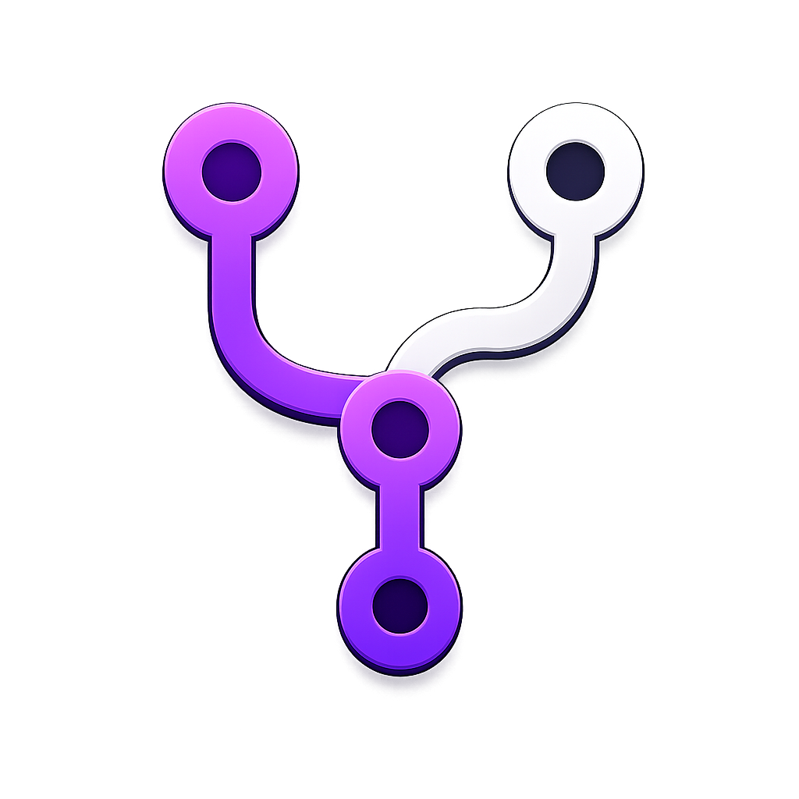
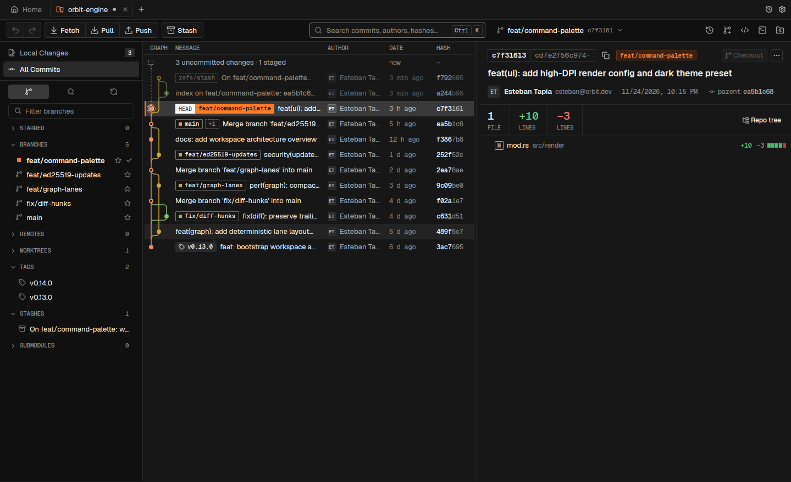
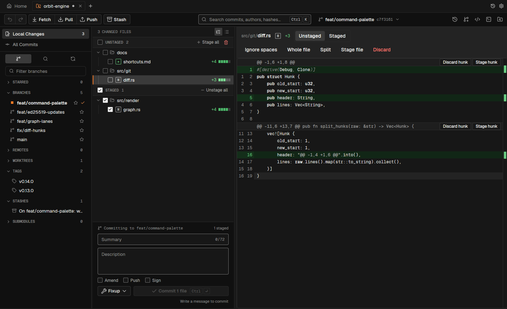
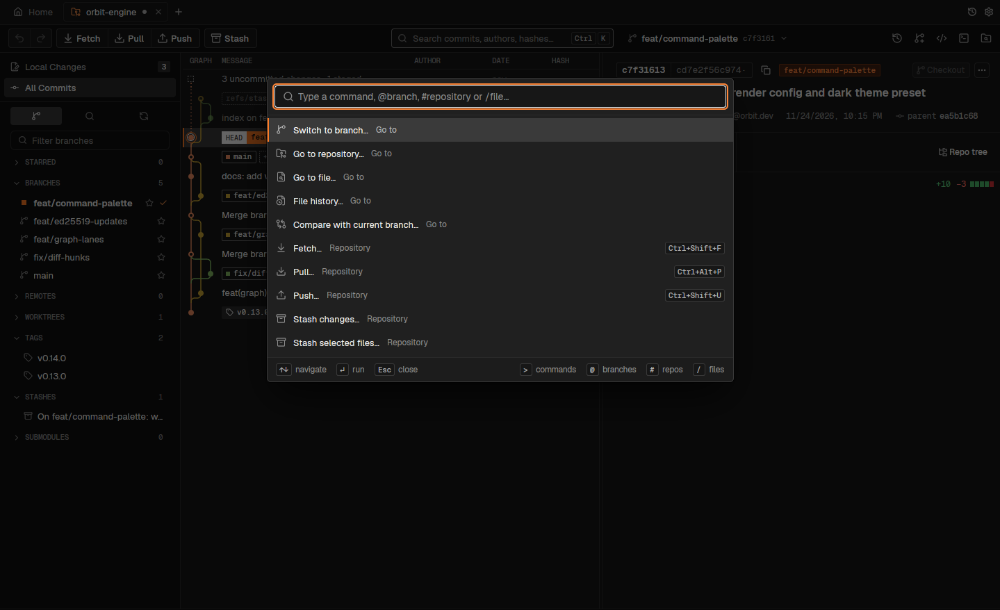
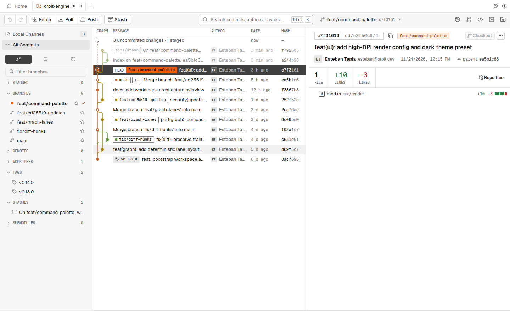

<div align="center">



# Mergeon

**A fast, GPU-accelerated desktop Git client written in Rust with [GPUI](https://www.gpui.rs/).**

[](LICENSE)
[](https://github.com/Spilveru/mergeon/actions/workflows/ci.yml)
[](https://github.com/Spilveru/mergeon/releases/latest)
[](https://www.rust-lang.org/)
[](#installation)

*Fast, native, keyboard-friendly Git workflows inspired by Fork — built for Linux, Windows, and macOS.*

<br />

<picture>
  <source media="(prefers-color-scheme: dark)" srcset="docs/screenshots/commits-dark.png" />
  <source media="(prefers-color-scheme: light)" srcset="docs/screenshots/commits-light.png" />
  
</picture>

</div>

---

## Screenshots

<table>
  <tr>
    <td width="50%">
      
      <br /><sub><b>Local Changes & Diff</b> — Stage/unstage by file, hunk, or line with syntax-highlighted diffs</sub>
    </td>
    <td width="50%">
      
      <br /><sub><b>Command Palette (<code>Ctrl+Shift+P</code>)</b> — Jump to commands, <code>@branches</code>, <code>#repos</code>, and <code>/files</code></sub>
    </td>
  </tr>
  <tr>
    <td colspan="2" align="center">
      
      <br /><sub><b>Light & Dark Themes</b> — Crisp native GPU-rendered UI with visual branch graph</sub>
    </td>
  </tr>
</table>

## Features

| Area | Highlights |
| --- | --- |
| **Commit History & Graph** | Visual commit graph, multi-commit selection, batch cherry-pick/revert, ref badges, search by message, author (`author:`), path (`path:`), branch (`branch:`), date (`after:`/`before:`), or code (`code:`/`regex:`) |
| **Local Changes & Diff** | Unified & split diffs with tree-sitter syntax highlighting, stage/unstage/discard by file, hunk, or individual lines, whole-file toggle, image diffs, in-diff search (`Ctrl+F` / `F7`) |
| **3-Way Conflict Resolver** | Built-in conflict resolution for text, binary, rename, and add/delete conflicts with ours/theirs/base panels and continue/abort/skip controls |
| **Branches, Worktrees & Stashes** | Interactive rebase, fixups & autosquash, branch comparison (`A...B` and direct), merged branch cleanup, selective stashes, Git worktrees, tags, remotes, and submodules |
| **Undo / Redo** | Per-repository undo/redo stack (`Ctrl+Z` / `Ctrl+Y`) covering commits, amends, merges, rebases, resets, branch/tag/stash ops, and file discards |
| **GitHub Integration** | OAuth device flow sign-in, repository browser & cloning, Pull Requests & CI check status right in the sidebar and status bar |
| **Workspace & Productivity** | Multi-repo tabs with named workspaces (repo groups), customizable keyboard shortcuts (`Ctrl+/`) with direct Fetch/Pull/Push and remembered dialog options, preview/pinned file tabs, file history (`--follow`) & navigable blame, command palette (`Ctrl+Shift+P`), light & dark themes, per-repo serialized Git mutation queue |

## Installation

Download prebuilt packages from [GitHub Releases](https://github.com/Spilveru/mergeon/releases/latest):

- **Linux (x86_64):** `.AppImage` (supports signed auto-updates) and `.deb` (Debian/Ubuntu, glibc ≥ 2.35)
- **Windows (x86_64) *(Beta)*:** `Mergeon-Setup-<version>.exe` (per-user NSIS installer)
- **macOS *(Beta)*:** `Mergeon-<version>-arm64-mac.zip` (when built with macOS release enabled)

> **Note:** Linux packages are built and verified end-to-end on real targets. Windows and macOS builds are compiled in CI and currently considered **beta** until broader real-hardware testing is complete — bug reports are very welcome!

## Building from Source

All source code lives in [`native/`](native/). Mergeon requires **Rust stable** (Edition 2024, see [`native/rust-toolchain.toml`](native/rust-toolchain.toml)) and **Git**.

### 1. Install System Dependencies

<details>
<summary><b>Linux (Debian / Ubuntu)</b></summary>

```bash
sudo apt-get update && sudo apt-get install -y \
  build-essential clang cmake pkg-config git python3 \
  libasound2-dev libfontconfig-dev libfreetype-dev libssl-dev \
  libvulkan-dev libwayland-dev libx11-xcb-dev libxcb1-dev \
  libxkbcommon-dev libxkbcommon-x11-dev libzstd-dev
```

For running GUI tests on a headless machine, also install `xvfb openbox mesa-vulkan-drivers`.
</details>

<details>
<summary><b>Windows</b></summary>

- Install [Rustup](https://rustup.rs/) with the MSVC toolchain (`x86_64-pc-windows-msvc`) and Visual Studio C++ Build Tools.
- Optional: install LLVM (`lld-link`) for faster test linking, and NSIS 3.x to build installers.
</details>

<details>
<summary><b>macOS</b></summary>

- Install Xcode Command Line Tools (including the Metal Toolchain for GPUI shaders) and [Rustup](https://rustup.rs/).
</details>

### 2. Run & Test

```bash
git clone https://github.com/Spilveru/mergeon.git
cd mergeon/native

# Launch Mergeon
cargo run -p mergeon

# Run the full test suite (use tools/in-x.sh on headless Linux)
cargo test --workspace --locked

# Lint & formatting checks
cargo fmt --all --check
cargo clippy --workspace --all-targets --locked -- -D warnings
```

## Architecture

Mergeon is structured as a layered Cargo workspace inside [`native/crates/`](native/crates/):

```text
mergeon (desktop binary, window shell, command palette, global shortcuts)
   └─ mergeon-view-{home, sidebar, toolbar, commits, changes, diff} + mergeon-ui
         └─ mergeon-app (AppModel GPUI entity, async flows, undo stack)
               └─ mergeon-backend (synchronous facade, OS keyring AES-256-GCM cipher, shell)
                     └─ mergeon-git-ops · mergeon-git-query · mergeon-runtime
                        mergeon-gitcmd · mergeon-model · mergeon-store
                        mergeon-github · mergeon-updater
```

Additional technical documentation lives in [`native/docs/`](native/docs/) (`app-layer.md`, `app-api.md`, `ui-components.md`, `packaging.md`).

### Vendored GPUI (`native/vendor/gpui-pre`)

Mergeon currently vendors a snapshot of `gpui-pre 0.3.7` (Zed's GPUI, Apache-2.0) with 4 small UI fixes documented in [`native/vendor/gpui-pre/MERGEON.md`](native/vendor/gpui-pre/MERGEON.md). Those patches remain licensed under **Apache-2.0** for upstream compatibility.

## Configuration & Releases

- **GitHub OAuth:** Uses GitHub's public OAuth Device Flow (no client secret). Override with `MERGEON_GITHUB_CLIENT_ID` if building a fork with your own OAuth/GitHub App (see [`.env.example`](.env.example)).
- **Signed Auto-Updates:** Releases built by [`.github/workflows/release.yml`](.github/workflows/release.yml) generate `latest*.yml` manifests signed with **Ed25519** (`latest*.yml.sig`) via `mergeon-manifest-check` (`MERGEON_UPDATE_SIGNING_KEY` secret + `MERGEON_UPDATE_PUBLIC_KEY` variable). Packaged builds enforce HTTPS and verify both the Ed25519 manifest signature and the installer SHA-512 checksum.

## Security

Please report security issues privately using [GitHub Security Advisories](https://github.com/Spilveru/mergeon/security/advisories/new). See [`SECURITY.md`](SECURITY.md) for details.

## Contributing

Contributions, bug reports, and ideas are welcome! Please read [`CONTRIBUTING.md`](CONTRIBUTING.md) and [`CODE_OF_CONDUCT.md`](CODE_OF_CONDUCT.md) before opening a pull request.

## License

Mergeon is licensed under the **GNU General Public License v3.0 or later** ([`LICENSE`](LICENSE)).
Third-party licenses and attributions are listed in [`native/THIRD-PARTY-NOTICES.md`](native/THIRD-PARTY-NOTICES.md).
